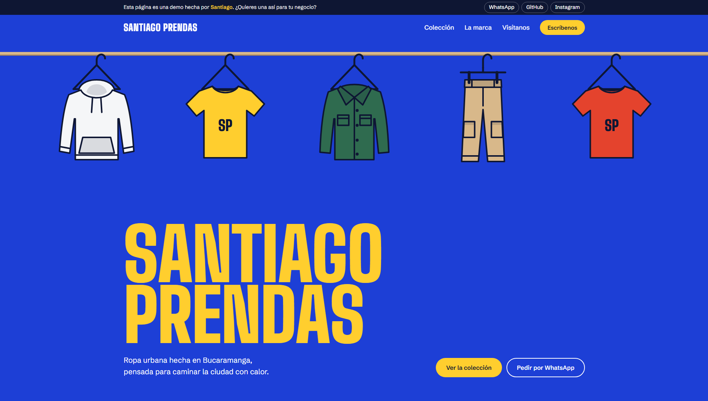

# Santiago Prendas

Demo de página web para una marca de ropa urbana. Santiago Prendas es una marca ficticia creada para mostrar el tipo de sitio que desarrollo para negocios locales.

**Ver demo:** https://santiago3336.github.io/Santiago_Clothes/



## Qué incluye

- La página no es una sola columna larga: está dividida en planos (Inicio, Colección, La marca y Visítanos). Se ve uno a la vez y se pasa de uno a otro con un deslizamiento. Un menú flotante acompaña el recorrido, al lado contrario de la lista «Prueba esta demo»: muestra el plano actual, tiene una flecha al siguiente y despliega todos con una frase de qué hay en cada uno. Al final de cada plano, una tarjeta invita al siguiente. La dirección cambia con cada plano, así que el botón «atrás» funciona. Sin JavaScript, la página se ve completa en una sola columna.
- Portada con ilustraciones animadas de prendas colgadas en un perchero que se mecen con el scroll y el toque.
- Catálogo de productos con filtro por categoría (las prendas se "recuelgan" al filtrar) y selector de talla que sella la etiqueta.
- Pedidos por WhatsApp con el mensaje ya escrito, incluyendo producto y talla.
- Horario de atención que indica si el local está abierto o cerrado en tiempo real (hora de Bogotá).
- Mapa ilustrativo de ubicación y, si el visitante lo pide, el mapa real de Bucaramanga en Google Maps (no se carga nada de Google antes de ese clic). La dirección es un espacio reservado: en la demo no se usa ningún lugar real.
- Lista «Prueba esta demo» que se marca al usar cada función, flota en una esquina y se acomoda en el bloque final al llegar a él.
- Diseño adaptable a celular, tableta y computador.
- Accesibilidad básica: navegación con teclado, textos alternativos y respeto por la opción del sistema de reducir movimiento.

## Tecnologías

HTML, CSS y JavaScript, sin frameworks ni dependencias. Todo el sitio está en un solo archivo (`index.html`), lo que lo hace liviano y fácil de publicar.

## Cómo verlo en tu computador

1. Clona el repositorio:
   ```bash
   git clone https://github.com/Santiago3336/Santiago_Clothes.git
   ```
2. Abre `index.html` en el navegador.

## Cómo adaptarlo a una marca real

Todo lo editable está al inicio del script dentro de `index.html`:

- `CONTACTO`: datos de contacto que aparecen en la barra de demo.
- `PRODUCTOS`: nombre, precio, descripción, tallas y colores de cada producto. Para usar fotos reales, escribe la ruta de la imagen en el campo `foto`, por ejemplo `"img/buzo.jpg"`.
- `PERCHA`: prendas que aparecen colgadas en la portada.

En la versión para un cliente, los botones de ejemplo se conectan al WhatsApp, Instagram y ubicación reales de la marca.

## Autor

Desarrollado por Santiago.

- GitHub: [Santiago3336](https://github.com/Santiago3336)
- ¿Quieres una página así para tu negocio? Escríbeme por [WhatsApp](https://wa.me/573155140200).
